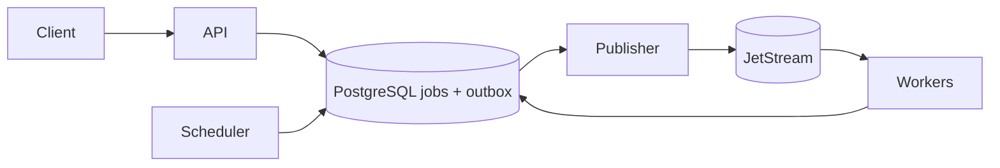

# Background Job Recovery

Background Job Recovery is a Go reference system for recovering interrupted jobs without duplicating committed PostgreSQL business actions. PostgreSQL owns job state and business effects; NATS JetStream provides durable at-least-once delivery.

## Reliability model

For the included order-fulfillment example, the fulfillment row and `SUCCEEDED` state commit in one PostgreSQL transaction. A unique order constraint prevents duplicate committed fulfillments, and finalization checks the current worker, generation, fencing epoch, and lease while holding the job row lock. A transactional outbox lets job submission commit independently of NATS availability.

Delivery and handler execution can repeat. The system does not promise exactly-once execution. External calls such as payments, email, or shipping require downstream idempotency or a separate outbox and idempotent consumer. Without provider idempotency or operation-status lookup, a timed-out remote outcome can remain uncertain.

## Architecture



The API validates and records jobs, the publisher delivers outbox events, workers claim and process jobs, and the scheduler releases retries and recovers expired leases. Workers reload authoritative job state from PostgreSQL; dispatch messages are notifications, not job records.

## Requirements

- Go 1.27 or newer
- Docker with the Docker Compose plugin
- OpenSSL for generating local development credentials

## Local setup

Create a private environment file and replace the password and token placeholders with independent random values. The generated hexadecimal values are safe to use in the example PostgreSQL URLs.

```sh
cp .env.example .env
openssl rand -hex 24
openssl rand -hex 24
# Put one value in POSTGRES_PASSWORD and both database URL entries;
# put the other in ADMIN_TOKEN.
make up
make demo
```

`.env` is ignored by Git. Compose requires the local configuration values, and the committed values are placeholders; generate unique password and token values before starting the stack. The local stack publishes its ports on loopback.

Inspect service statistics at <http://127.0.0.1:8080/api/stats>. The embedded dashboard is served at <http://127.0.0.1:8080/>. Mutating API requests require the configured `ADMIN_TOKEN`.

To submit a job directly, set the environment variables from `.env` before running the CLI, or use the HTTP API with an idempotency key:

```sh
set -a; . ./.env; set +a
curl -X POST http://127.0.0.1:8080/api/jobs \
  -H 'Content-Type: application/json' \
  -H "Authorization: Bearer $ADMIN_TOKEN" \
  -d '{"job_type":"generate_report","idempotency_key":"report-example-1","payload":{}}'
```

Seed and verify a run with `job-recovery demo seed --count 100` and `job-recovery demo verify --run-id RUN_ID`. Run `make chaos-demo` to force-kill a worker while it owns active jobs, wait for lease recovery, and verify run-scoped business effects. The verifier reports failure unless the persisted results meet its integrity checks.

## Development checks

```sh
make test
make test-race
make lint
make build
make test-integration
```

Unit tests run with `make test`. Database and NATS integration tests require the Compose services and are enabled by `make test-integration`. CI starts PostgreSQL and NATS and requires those integration tests to run. The repository does not yet include benchmark fixtures or report measured throughput.

## Scope and limitations

This project demonstrates PostgreSQL transaction boundaries, idempotency, leases, fencing, retries, an outbox, and recovery. Its single-node Compose setup does not demonstrate infrastructure high availability. The integration suite covers core database and message invariants; it does not cover the full outage and failure-injection matrix. Metrics are persisted counters and gauges without latency histograms. Review [limitations](docs/limitations.md) and the [crash matrix](docs/crash-matrix.md) before using the system as a basis for another service.

## Documentation

- [Architecture](docs/architecture.md)
- [Job lifecycle](docs/job-lifecycle.md)
- [Reliability guarantees](docs/reliability-guarantees.md)
- [Crash matrix](docs/crash-matrix.md)
- [Runbook](docs/runbook.md)
- [Performance](docs/performance.md)
- [Limitations](docs/limitations.md)
- [Contributing](CONTRIBUTING.md)
- [Security policy](.github/SECURITY.md)

## License

MIT. See [LICENSE](LICENSE).
